<div align="center">

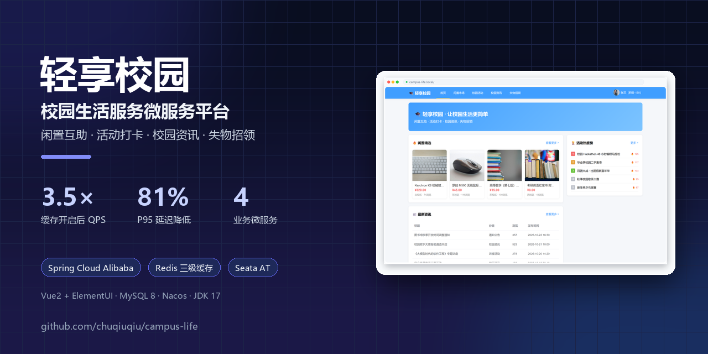

<h1>轻享校园 · 校园生活服务平台</h1>

<p><b>面向高校师生的轻量化校园综合服务微服务平台</b></p>

<p>闲置互助 · 活动打卡 · 校园资讯 · 失物招领</p>

<p>
  
  
  
  
  
  
  
  
  
</p>

<p>
  <a href="#performance">性能数据</a> ·
  <a href="#architecture">系统架构</a> ·
  <a href="#screenshots">项目截图</a> ·
  <a href="#quickstart">快速开始</a> ·
  <a href="docs/部署文档.md">部署文档</a> ·
  <a href="docs/benchmark.md">压测报告</a>
</p>

</div>

---

## 🎯 这是什么

`campus-life` 是一个**校园生活服务微服务项目**，把「黑马商城」的微服务架构、「黑马点评」的 Redis 高级场景、「苍穹外卖」的业务规范，压缩到四个校园业务域中：

- **校园闲置**：发布、检索、详情、收藏、浏览量统计；
- **校园活动**：发布、报名、打卡、点赞、热度排行榜；
- **校园资讯**：发布、点赞、浏览量；
- **失物招领**：发布、检索、状态流转。

项目刻意**去掉了商城、支付、订单模块**，把重点放在微服务治理与 Redis 高并发场景上，适合作为课程设计、毕业设计或 Java 后端求职作品。

## 📊 性能速览

> 压测接口：`GET /items/page?pageNo=1&pageSize=8`，直连 `item-service`，隔离网关与 Feign 开销，专门验证「关闭缓存 → 开启三级缓存」的收益。

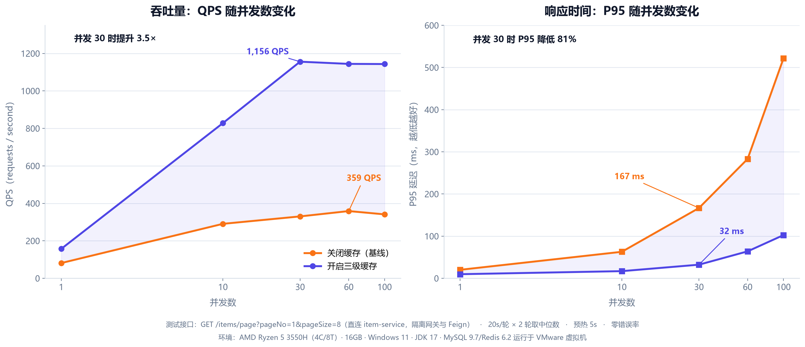

| 并发 | 关闭缓存 QPS | 开启缓存 QPS | QPS 提升 | 关闭缓存 P95 | 开启缓存 P95 | P95 降低 |
|---:|---:|---:|---:|---:|---:|---:|
| 1 | 81 | 157 | 1.9× | 20 ms | 10 ms | 52% |
| 10 | 291 | 828 | 2.8× | 63 ms | 17 ms | 73% |
| 30 | 330 | **1,156** | **3.5×** | 167 ms | **32 ms** | **81%** |
| 60 | 359 | 1,144 | 3.2× | 283 ms | 64 ms | 77% |
| 100 | 341 | 1,143 | 3.4× | 522 ms | 103 ms | 80% |

- **峰值 QPS：359 → 1,156（3.2×）**
- **并发 30 时 P95：167 ms → 32 ms（下降 81%）**
- 测试环境：AMD Ryzen 5 3550H（4C/8T）/ 16GB / Windows 11 / JDK 17；MySQL、Redis 运行于 VMware 虚拟机；20s/轮 × 2 轮取中位数，预热 5s，错误率 0%。
- 完整方法、原始数据与复现命令：[docs/benchmark.md](docs/benchmark.md)
- 关闭缓存的基线分支：[`benchmark/no-cache`](https://github.com/chuqiuqiu/campus-life/tree/benchmark/no-cache)

> 本机单机压测的绝对数字受 CPU 和虚拟机资源限制，结论应理解为**同环境下的相对收益**，不代表生产环境容量。

<a name="screenshots"></a>

## 🖼️ 项目截图

> 截图来自本地真实启动的前后端服务；演示数据为校园场景样例数据。

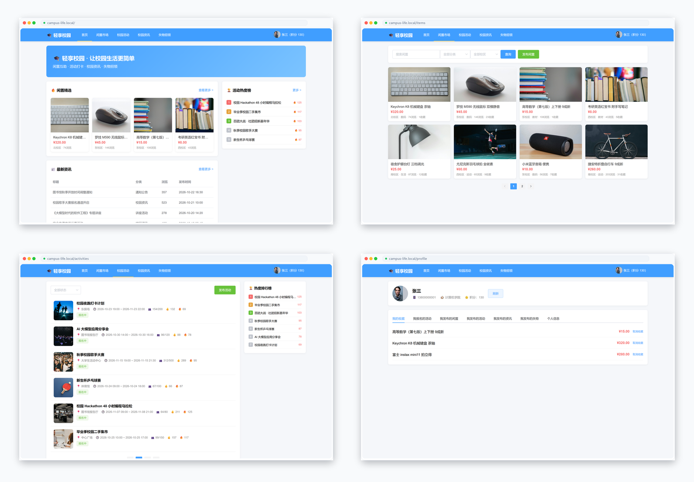

| 活动详情（Lua 报名） | Knife4j 接口文档 |
|---|---|
| 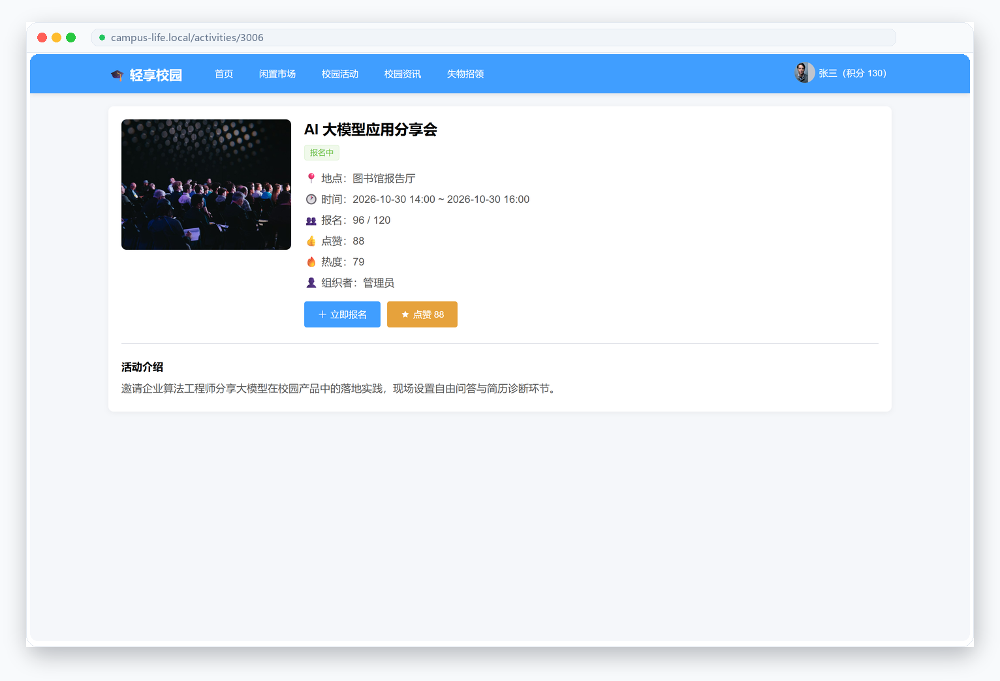 | 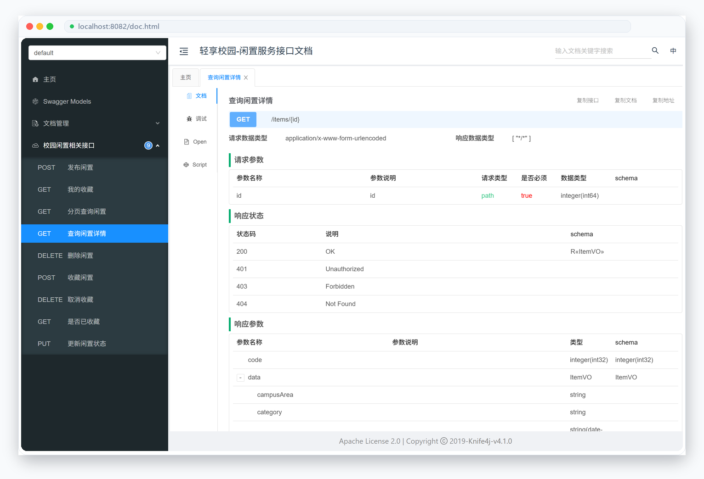 |

<details>
<summary><b>展开更多：Nacos 服务注册</b></summary>

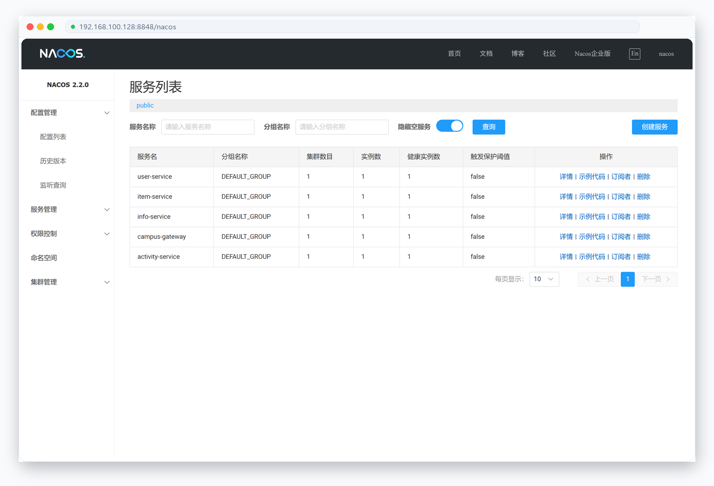

</details>

## ✨ 核心能力

| 模块 | 核心功能 | 技术实现 |
|---|---|---|
| **校园闲置** | 发布 / 检索 / 详情 / 收藏 / 浏览量 | **Caffeine + Redis + MySQL 三级缓存**；SETNX 互斥锁防击穿；空值缓存防穿透；随机 TTL 防雪崩；Redis 浏览量增量异步落库；**Seata AT** 保证「发布闲置 + 加积分」跨服务一致性 |
| **校园活动** | 发布 / 报名 / 打卡 / 点赞 / 热度榜 | **Lua 脚本原子扣减名额防超卖**；Redis 全局唯一 ID 生成报名凭证；Set 实现一人一赞；ZSet 维护热度排行榜；活动状态按时间动态计算 |
| **校园资讯** | 发布 / 点赞 / 浏览量 | 热点列表缓存；浏览量「DB 存量 + Redis 增量」统一口径；点赞去重 |
| **失物招领** | 发布 / 检索 / 状态流转 | Redis 全局唯一编号；失物 / 招领双类型；状态流转 |
| **用户中心** | 注册 / 登录 / JWT / 会话 / 积分 | BCrypt 密码哈希；Redis 会话缓存 + 滑动续期；**Redis Lua IP 限流**（登录 10 次/分钟、注册 5 次/分钟） |
| **统一网关** | 统一入口 / 鉴权 / 跨域 / 路由 | JWT 校验；白名单**接口粒度**放行；登录态透传；Spring Cloud Gateway + LoadBalancer |
| **公共模块** | 统一返回 / 异常 / 工具 / 限流 / Feign | `R<T>` 统一响应、全局异常处理、`RedisIdWorker`、IP 限流器、OpenFeign 配置 |

<a name="architecture"></a>

## 🏗️ 系统架构

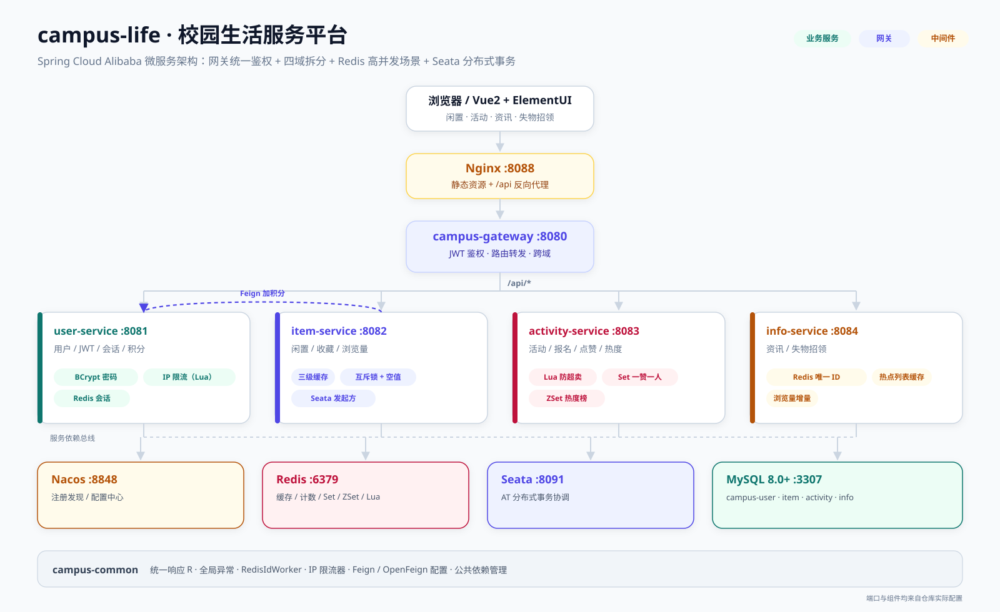

| 组件 | 端口 | 职责 |
|---|---|---|
| `campus-gateway` | 8080 | 统一入口、JWT 鉴权、路由转发、跨域 |
| `user-service` | 8081 | 用户、登录、会话、积分、限流 |
| `item-service` | 8082 | 闲置、收藏、浏览量、三级缓存、Seata 发起方 |
| `activity-service` | 8083 | 活动、报名、打卡、点赞、热度榜 |
| `info-service` | 8084 | 资讯、失物招领 |
| Nginx | 8088 | 前端静态资源 + `/api` 反向代理 |
| Nacos | 8848 | 服务注册发现 + 共享配置中心 |
| Redis | 6379 | 缓存、计数、Set/ZSet、Lua、会话、限流 |
| Seata Server | 8091 | AT 模式分布式事务协调 |
| MySQL 8.0+ | 3307 | 四个独立业务库 + `undo_log` |

**设计要点：**

- **按业务域拆库**：`campus-user`、`campus-item`、`campus-activity`、`campus-info` 四个独立库，服务之间不直接访问对方的库；
- **网关只做入口治理**：JWT 校验、白名单、跨域、路由，不把业务逻辑堆到网关；
- **服务间调用显式补齐 LoadBalancer**：解决 Spring Cloud 2021 中 OpenFeign 按服务名调用时的 DNS 解析问题；
- **公共能力下沉到 `campus-common`**：统一响应、异常、ID 生成、限流、Feign 配置。

## 🔍 核心链路

### 1. 闲置详情：三级缓存 + 防穿透 / 击穿 / 雪崩

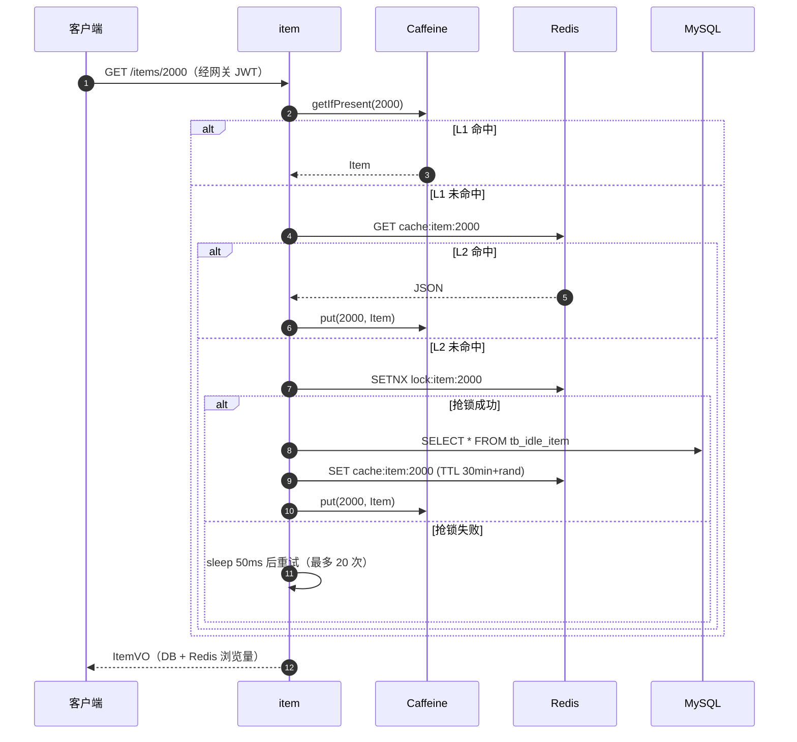

- **穿透**：查库为空时写入空字符串，TTL 2 分钟；
- **击穿**：Redis `SETNX` 互斥锁 + 双重检查，只允许一个线程回源；
- **雪崩**：Redis TTL 增加 0~300 秒随机偏移，避免同一时刻集中失效；
- **一致性**：发布、收藏、状态变更后主动清理 Caffeine + Redis + 列表缓存。

### 2. 活动报名：Lua 原子扣减 + 全局唯一 ID

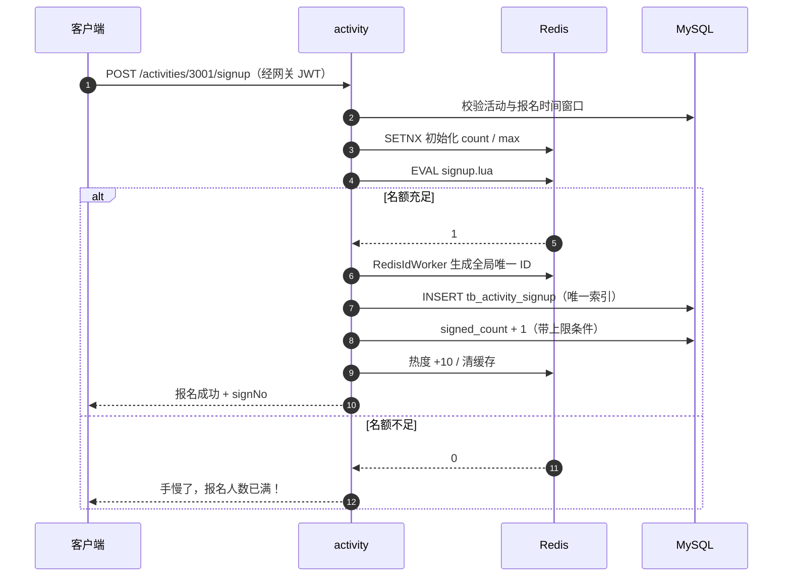

- Lua 脚本在 Redis 内**原子执行**，避免「先查后减」的并发超卖；
- 数据库唯一索引兜底同一用户重复报名；
- 报名凭证编号由 `RedisIdWorker` 生成，不依赖数据库自增；
- 取消报名会回滚 Redis 名额、DB 报名数和活动热度。

### 3. 发布闲置：Seata AT 分布式事务

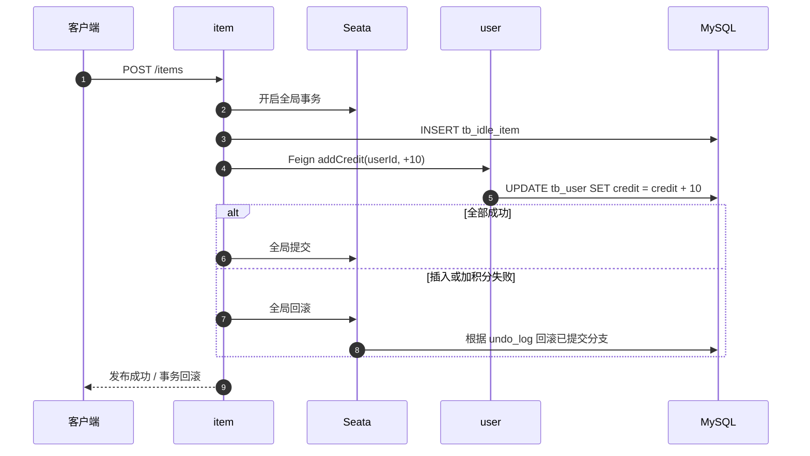

`item-service` 的发布方法使用 `@GlobalTransactional`，`user-service` 的加积分方法作为 AT 分支参与方；两个库都包含 `undo_log` 表。

<a name="data-model"></a>

## 🗄️ 数据模型

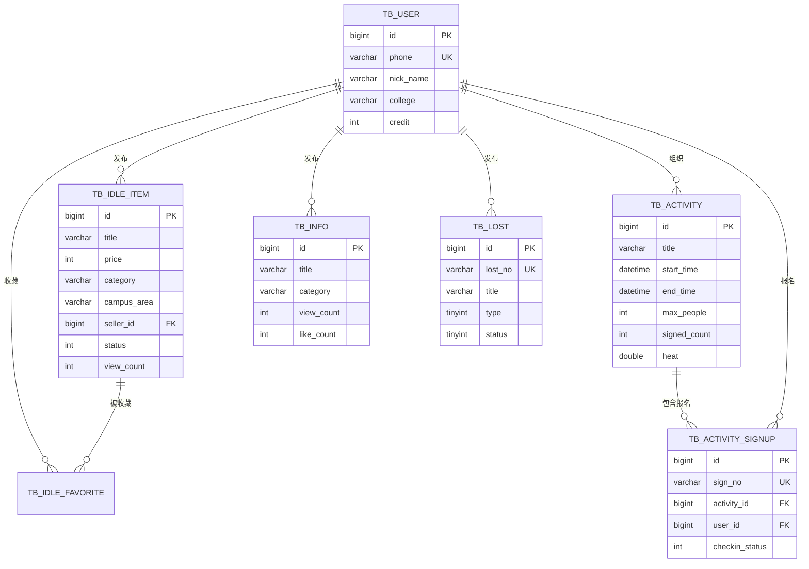

四个库物理隔离，表之间不建跨库外键；一致性由业务约束、唯一索引和 Seata 事务保证。

<a name="performance"></a>

## ⚡ 缓存优化：为什么快

压测对比的不是「有没有 Redis」，而是 **item-service 的列表查询是否走缓存**：

| 路径 | 关闭缓存（基线） | 开启三级缓存 |
|---|---|---|
| 请求处理 | 每次 `COUNT + LIMIT` 查 MySQL | Caffeine → Redis → MySQL |
| 数据库压力 | 并发越高，连接池排队越明显 | 热点数据不打库 |
| P95 延迟 | 随并发快速上升（最高 522 ms） | 稳定在 32~103 ms |
| 峰值 QPS | 359 | 1,156 |

优化点不止「加一个 Redis」：

1. **本地 + 分布式两级缓存**：Caffeine 抗单机热点，Redis 做集群共享；
2. **互斥锁 + 双重检查**：缓存失效瞬间只放一个请求回源；
3. **空值缓存**：不存在的 id 也缓存 2 分钟，避免恶意穿透；
4. **随机 TTL**：TTL 增加随机偏移，避免缓存同时过期；
5. **浏览量增量合并**：Redis 先累加，定时任务批量落库，避免每次浏览都 `UPDATE`；
6. **列表缓存只存 DB 原始值**：叠加浏览量在返回前做，避免缓存值被重复累加。

复现方式、基线分支和原始 JSON 见 [docs/benchmark.md](docs/benchmark.md)。

<a name="quickstart"></a>

## 🚀 快速开始

### 1. 准备中间件

项目使用 MySQL 8.0+、Redis 6.2+、Nacos、Seata。示例环境把中间件放在 `192.168.100.128` 的 Docker 中：

| 组件 | 地址 / 端口 | 账号 |
|---|---|---|
| MySQL | `192.168.100.128:3307` | `root / 123` |
| Redis | `192.168.100.128:6379` | 无密码 |
| Nacos | `http://192.168.100.128:8848/nacos` | `nacos / nacos` |
| Seata | `192.168.100.128:8091` | - |

```bash
# 在虚拟机中启动容器（容器名以实际为准）
docker start mysql redis nacos seata-server
```

### 2. 初始化数据库

```bash
# 方式 A：在虚拟机内执行
docker exec -i mysql mysql -uroot -p123 < sql/campus_init.sql

# 方式 B：从宿主机连接
mysql -h 192.168.100.128 -P 3307 -uroot -p123 < sql/campus_init.sql
```

脚本会创建四个业务库、业务表和 Seata `undo_log` 表。

### 3. 导入 Nacos 共享配置

在 Nacos 控制台新建以下配置（Data ID / Group 均为 `DEFAULT_GROUP`，格式 YAML）：

- `shared-log.yaml`
- `shared-swagger.yaml`
- `shared-seata.yaml`

对应文件在 [`docs/nacos/`](docs/nacos/)。

### 4. 启动后端

```bash
mvn clean package -DskipTests

# 按依赖顺序启动；JDK 17 若遇到 cglib 反射问题，追加 --add-opens java.base/java.lang=ALL-UNNAMED
java -jar user-service/target/user-service.jar
java -jar item-service/target/item-service.jar
java -jar activity-service/target/activity-service.jar
java -jar info-service/target/info-service.jar
java -jar campus-gateway/target/campus-gateway.jar
```

启动后可在 Nacos「服务管理」中看到 5 个服务实例，网关地址为 `http://localhost:8080`。

### 5. 启动前端

```bash
cd nginx/html/campus-life-web
npm install
npm run serve
```

开发服务器默认 `http://localhost:8088`，`/api` 代理到网关。生产构建：

```bash
npm run build
# 将 dist 部署到 nginx/html/campus-life-web/dist，使用 nginx/conf/nginx.conf
```

### 演示账号

| 手机号 | 密码 | 说明 |
|---|---|---|
| `13800000001` | `123` | 普通用户（张三） |
| `13800000002` | `123` | 普通用户（李四） |
| `13800000003` | `123456` | 管理员（可删除活动） |

## 📁 目录结构

```text
campus-life/
├── campus-common/          # 统一返回 / 异常 / RedisIdWorker / 限流器 / Feign 配置
├── campus-gateway/         # 网关：路由 / JWT 鉴权 / 白名单 / 跨域
├── user-service/           # 用户：登录 / 会话 / 积分 / IP 限流
├── item-service/           # 闲置：三级缓存 / 收藏 / 浏览量 / Seata 发起方
├── activity-service/       # 活动：Lua 报名 / 点赞 Set / 热度 ZSet / 打卡
├── info-service/           # 资讯 / 失物招领
├── sql/                    # 四个业务库 + undo_log 初始化脚本
├── nginx/                  # Vue2 前端源码 + Nginx 配置
├── benchmark/              # 压测脚本 + 优化前后原始结果
├── docs/
│   ├── assets/             # 架构图、截图、压测图表
│   ├── nacos/              # Nacos 共享配置
│   ├── 部署文档.md
│   └── benchmark.md
└── pom.xml                 # 父工程：版本与依赖管理
```

## 📚 文档

- [部署文档（含常见问题排查）](docs/部署文档.md)
- [缓存优化压测报告（环境 / 方法 / 原始数据）](docs/benchmark.md)

## ⚠️ 说明

- 本项目是**学习 / 求职作品**，不是生产级系统；生产环境还需要补充鉴权细化、配置加密、可观测性、CI/CD、容器编排和容量规划。
- 截图和压测数据均来自本地真实运行结果；演示数据为校园场景样例数据。
- 压测环境为单机 + VMware 虚拟机，绝对 QPS 会受 CPU、JVM 堆大小和客户端生成能力影响，请重点关注**同环境下的优化前后对比**。

## 📄 License

[MIT](LICENSE)